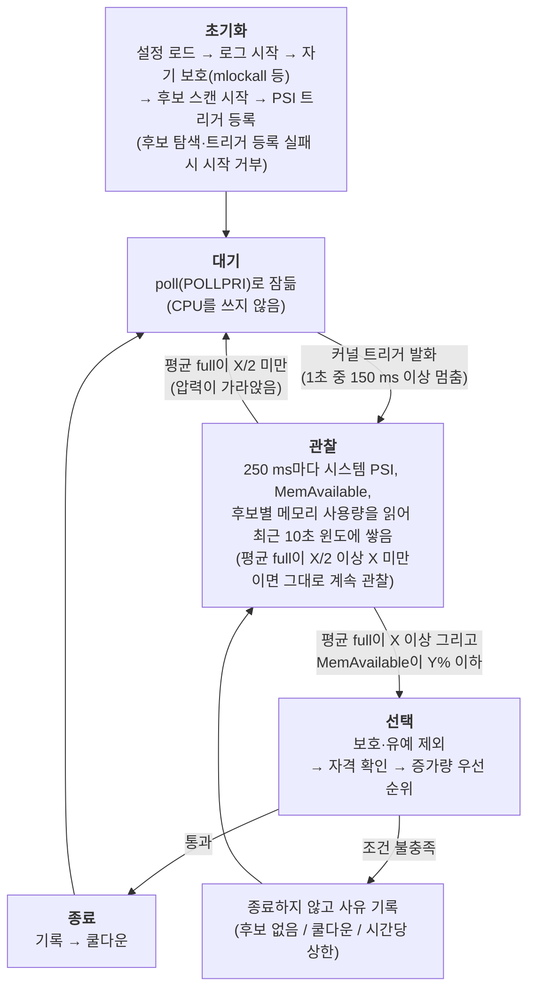

# Thrash Guard 데몬 설계

> 데몬이 **언제 개입하고, 누구를 종료하고, 어떻게 종료하는지**의 핵심을 설명한다. 목적은 [plan.md](../plan.md), 검증은 [validation/overview.md](../validation/overview.md)에 있다.
> 수치는 모두 측정 전 임시값이며, 확인하지 못한 것은 "미확인", 추론은 "추론"으로 표시한다.

## 1. 한눈에 보기

데몬은 평소에 잠들어 있다가 커널이 "메모리 압력이 높다"고 알려 주면 깨어난다. 압력이 정말 지속되는지 짧게 지켜보고,
지속되면 메모리를 가장 많이 점유한 쪽을 골라 종료한다.

## 2. 언제 개입하나

| 입력 | 출처 | 역할 |
|---|---|---|
| 시스템 PSI `full` | `/proc/pressure/memory`의 `total`(누적 stall 시간) 차분 | 깨우기와 지속 판단 |
| `MemAvailable` | `/proc/meminfo` | 여유 메모리 보호선: 압력이 높아도 메모리가 넉넉하면 종료하지 않음 |

- `full`은 "일하고 있거나 일하려는 모든 작업이 메모리 때문에 동시에 멈춘 시간의 비율"이다. 스래싱에서는 모든 작업이 같은 페이지를 디스크에서 다시 읽으려고 줄을 서므로 크게 오른다.
  `some`(일부 작업이라도 멈춤)은 정상 버스트에서도 쉽게 올라 임계값의 근거가 없어 쓰지 않는다.
- **두 단계 확인**: 커널 트리거가 데몬을 깨우고, 깨어난 뒤에는 **윈도**(최근 10초의 샘플 모음)의 평균으로 일시 버스트와 지속되는 스래싱을 구분한다.
  평균은 샘플 수가 아니라 실제 경과 시간으로 나눠 데몬이 밀려도 비율이 틀어지지 않는다. 짧은 stall을 놓치는 `avg10`은 쓰지 않고 `total`의 증가분으로 직접 계산한다.
- **한계**: 최소 감지 지연은 약 10초(트리거 이전 기록이 없어 윈도가 차야 함). 짧지만 센 버스트(예: 3초간 60%)는 평균이 임계를 넘어 오탐할 수 있다.
  필수 프로세스가 보호받아 계속 돌면 시스템 `full`이 낮게 유지되어 워크로드만 스래싱하는 상황을 놓칠 수 있다(추론). 검증에서 확인하고, 놓치면 대상 구역의 `full`을 함께 본다.

## 3. 누구를 종료하나

**압력은 "시스템이 위험하다"를 알리는 데만 쓰고, 희생자는 메모리 사용량으로 고른다.** PSI는 메모리 때문에 *멈춘* 쪽을 재므로 원인이 아니라 피해자를 가리킬 수 있다.
메모리를 크게 쥐고 잠든 프로세스는 자기 PSI가 0이다. 비슷한 도구(oomd, earlyoom, nohang)도 감지는 압력·여유량으로, 선택은 크기로 한다.

종료 단위는 cgroup이고, 후보는 `target_parent`의 직계 자식 중 **이름이 `target_match`에 맞는 것**이다.

| 설정 | 의미 | 성격 |
|---|---|---|
| `target_match` | 여기까지만 죽일 수 있다(허용 범위) | 허용 목록. 데몬 설정에 이름 패턴을 쉼표로 적는다(`*`만 특별). 기본값은 컨테이너 런타임의 cgroup 이름(`docker-*.scope,libpod-*.scope,cri-containerd-*.scope,crio-*.scope`, 임시, VM에서 확인 필요). 서비스를 후보로 쓰려면 이름을 직접 적고, 전부 쓰려면 `*`를 적는다 |
| 보호(`OOMScoreAdjust=-1000`) | 그 안에서도 이건 죽이지 않는다(예외) | 거부 목록. 각 서비스 설정에 적는다 |

두 장치는 실패하는 방식이 달라 겹쳐 쓴다. 허용 범위에 필수 서비스가 잘못 들어가도 보호 표시가 막고, 보호 표시를 빠뜨려도 허용 범위 밖이면 후보가 아니다.
기본 `target_parent`는 `/sys/fs/cgroup/system.slice`다(서비스를 등록하면 보통 여기에 들어가므로, 도커 호스트는 설정 없이 컨테이너만 후보가 된다). 이름에 맞는 cgroup이 하나도 없으면 데몬은 시작하되 "아무것도 종료하지 않는다"는 경고를 로그에 남긴다.
프리셋(이름 하나로 패턴 묶음을 쓰는 방식)과 내장 제외 목록은 만들지 않았다. 일반 서비스는 사용자가 이름을 직접 적는다. dry-run 로그의 후보별 지표로 어떤 이름을 넣을지 확인할 수 있다.

1. **제외**: 보호된 cgroup([design/protection.md](protection.md)), 시작 직후 유예 중, 윈도가 덜 찬 후보.
2. **자격**: 최근 10초 최대 사용량(`memory.current`)이 전체 메모리의 10% 이상이어야 한다. 미달이면 종료하지 않고 `no_culprit`으로 기록한다.
3. **순위**: 윈도 안 증가량(최대 사용량 − 첫 샘플의 사용량)이 전체의 1% 이상인 후보가 있으면 **증가량이 가장 큰 것**, 없으면 **최대 사용량이 가장 큰 것**. 동률은 앞 번호.

천천히 계속 늘어나는 프로세스(누수형)는 한꺼번에 키운 뒤 가만히 있는 프로세스보다 먼저 선택된다. 윈도 안에서 한꺼번에 늘어난 프로세스는 증가량이 크므로 역시 선택된다.

**한계**: 데몬은 프로세스의 의도를 알 수 없다. 시작하며 늘어나는 중인 정상 앱은 선택될 수 있고(유예와 보호로 완화), 이미 많이 쥔 채 가만히 있는 프로세스는 증가 중인 후보가 없을 때만 선택된다.
지켜야 할 앱은 보호 설정으로 지정해야 한다. 후보별 사용량과 증가량은 모두 로그에 남겨 규칙을 사후에 점검한다. 근거와 예시는 [design/victim-selection.md](victim-selection.md)에 있다.

## 4. 어떻게 종료하나

MVP는 `cgroup_kill` 한 가지다. 선택한 cgroup의 `cgroup.kill`에 `1`을 쓴다(희생자 선택은 3절).

`cgroup.kill`은 같은 SIGKILL을 cgroup 안의 모든 프로세스에 **커널이 한꺼번에 전달**하는 기능이다(리눅스 5.14 이상). pid 목록을 읽지 않아 스래싱 중에도 파일 쓰기 한 번으로 끝나고,
목록을 읽은 뒤 새로 생긴 프로세스를 놓치거나 pid가 재사용되어 엉뚱한 프로세스를 죽일 위험이 없다.

**구현 규칙**: 종료 함수(`src/daemon/killer`)는 `target_parent`를 연 디렉터리 핸들과 cgroup 이름을 받아, 이름을 검증한 뒤(`/` 포함, `.`, `..`, 빈 이름, 용량 초과는 거부)
그 핸들 기준 `openat`으로 `<이름>/cgroup.kill`을 열어 `1`을 쓴다. dry-run은 호출자(이벤트 루프)가 처리하고 종료 함수는 모른다. 실패 이유는 음수 errno로 구분한다
(`-ENOENT` cgroup이 이미 없음, `-ENOTSUP` 이 커널에 `cgroup.kill` 없음, `-EACCES` 권한 없음, `-EINVAL` 잘못된 이름, `-ESTALE` 샘플링한 cgroup이 아님).
엔진은 샘플링할 때 열어 둔 `memory.current` fd와 종료 직전에 같은 이름으로 다시 찾은 cgroup의 `memory.current`가 같은 파일인지 확인한 뒤에만 쓴다(그 사이 같은 이름으로 cgroup이 다시 만들어진 경우 방지). 확인과 쓰기는 한 번 연 디렉터리 핸들로 한다. 반환 성공은 "신호를 전달했다"까지이고 종료 확인은 PSI가 가라앉는지로 한다.

**`oom_kill`은 MVP에서 뺀다**: `/proc/sysrq-trigger`에 `f`를 써 커널 OOM killer를 실행하는 방식인데, 커널이 시스템 전체에서 고르므로 `target_parent` 아래만 종료한다는 안전 원칙과 맞지 않고
3절의 선택 규칙도 쓰지 못하며, 세부 동작도 확인하지 못했다. 필수와 문제 프로세스가 한 cgroup에 섞인 경우의 보완책은 후속(M5)에서 범위 문제와 함께 설계한다.

**종료와 CPU**: 두 방식 모두 "파일에 쓴다"는 것은 시스템 콜이다. 데몬 스레드가 CPU를 받아 `write()`를 실행하면 커널이 그 호출 안에서 대상에 SIGKILL을 표시하고 깨운다(별도 커널 프로세스가 파일을 감시하는 구조가 아니다).
실제로 사라지는 것은 대상이 CPU를 받아 종료 처리를 마친 뒤이고, 디스크 입출력을 기다리는 상태의 대상은 그 대기가 끝나야 한다. 그래서 CPU가 포화되면 `write()` 시작과 대상의 종료가 모두 늦어질 수 있다.
이 프로젝트가 겨냥한 스래싱은 CPU보다 메모리·입출력 병목이고, 그쪽은 `mlockall`로 대비한다. CPU 경쟁은 보호하지 못하는 **한계**이며, 서비스 파일(M3-8)에 `CPUWeight` 상향을 넣고 M4에서 CPU 부하를 섞어 확인한다.

## 5. 이벤트 루프와 시작 순서

메인 스레드가 이벤트 루프다. 기록 스레드(로그)와 스캔 스레드(후보 표)는 시작 단계에서 띄워 두고, 메인은 `poll()` 하나로 세 가지를 기다린다.

| 기다리는 것 | 오는 때 | 처리 |
|---|---|---|
| 종료 신호(`signalfd`) | `systemctl stop`의 SIGTERM, SIGINT | 루프를 빠져나와 정리하고 끝낸다. SIGHUP은 받아서 버린다(다시 읽기 미지원) |
| 커널 PSI 트리거(`POLLPRI`) | 1초 중 150 ms 이상 멈춤 | 관찰을 시작한다. 관찰 중이면 무시한다 |
| 다음 틱 시각 | 관찰 중에만, 250 ms마다 | 샘플을 읽고 판단 함수를 부른다 |

관찰 중이 아니면 대기 시간 없이(무한) 잠든다. 틱 시각은 별도 타이머 fd 없이 `poll`의 대기 시간으로 처리한다. 틱 사이의 간격이 조금 흔들려도 판단 함수가 실제 경과 시간으로 평균을 내므로 정확한 주기는 필요하지 않다.

**시작 순서**: ① 신호를 막고 `signalfd`를 만든다(어떤 스레드보다 먼저. 새 스레드는 막힌 상태를 물려받아 어느 스레드도 신호로 끊기지 않는다. SIGPIPE는 무시한다) → ② 설정 로드·검증 → ③ 로그 시작 → ④ 자기 보호(`mlockall`, `oom_score_adj`) →
⑤ 후보 스캔 시작(첫 스캔은 동기) → ⑤' 환경 점검(아래) → ⑥ 엔진 준비(`/proc/pressure/memory`, `/proc/meminfo`를 한 번 열어 둠) → ⑦ PSI 트리거 등록 → ⑧ 루프. 자기 보호가 실패하면 경고만 남기고 계속하지만,
**후보 탐색이나 트리거 등록에 실패하면 시작을 거부한다**(종료 코드 4). 안전장치가 켜진 척하면서 아무것도 못 하는 상태가 가장 위험하기 때문이다. 트리거 없이 항상 감시하는 대체 모드는 만들지 않았다.

**환경 점검**(`envcheck`): 종료 때에야 드러날 환경 문제를 시작할 때 확인한다. 확인 항목은 ① `target_parent`가 cgroup v2 파일 시스템인지, ② `target_parent`의 `cgroup.subtree_control`에 `memory`가 있는지(없으면 자식에 `memory.current`가 없다), ③ 첫 후보의 `cgroup.kill`이 있고 쓸 수 있는지(커널 5.14 이상)이다. 문제가 있으면 dry-run은 경고만 남기고 시작한다(판단 로그를 보는 용도는 쓸 수 있다). **실제 종료 모드는 시작을 거부한다**(종료 코드 4). 후보가 하나도 없으면 ③은 확인하지 못하고 "후보 없음" 경고만 남는다. 후보가 나중에 생겼을 때 `cgroup.kill`이 없는 경우는 종료 시점에 `-ENOTSUP`으로 드러난다.

**틱 한 번의 처리**(`engine`): 후보 표를 잡고 → 샘플 수집(시스템 PSI `full` 누적, `MemAvailable`, 후보별 `memory.current`를 `pread`로 읽음) → 판단 함수 → 결정 처리 → 표를 놓는다.
시스템 값을 읽지 못하면 그 틱은 판단하지 않고 계속 관찰한다(지속되면 한 번 경고). 후보 하나의 `memory.current`를 읽지 못하면 그 후보만 뺀다.

| 결정 | 처리 |
|---|---|
| 관찰 계속 | 없음 |
| 건너뜀(후보 없음, 자격 미달, `MemAvailable` 충분, 쿨다운, 시간당 상한) | 사유 로그(같은 사유는 관찰당 한 번). 계속 관찰한다. 쿨다운이 끝나면 아직 스래싱일 때 바로 종료한다 |
| 진정(평균 full이 X/2 미만) | 로그 후 관찰을 끝내고 다시 잠든다 |
| 종료 | dry-run이면 로그만, 아니면 `cgroup.kill`을 쓴다. 성공하면(dry-run 포함) 정책에 기록해 쿨다운과 상한을 소모한다. 실패하면 기록하지 않아 다음 관찰에서 다시 시도한다. 종료 줄 뒤에 후보별 지표(최대 사용량, 증가량, 자격, 유예)를 남긴다 |

**로그는 사건과 요약만** 남긴다: 시작·종료, 트리거, 건너뜀, 진정, 종료와 후보별 지표, 지연 경고, 샘플 읽기 실패, 후보 표 가득 참, 종료 시 통계 요약. 관찰 중 틱마다 남기지 않는다(로그 용량이 커지지 않게).

**루프 지연**: 틱이 예정보다 틱 간격의 2배 이상 늦으면 관찰당 한 번 경고하고 통계(`late_ticks`, `max_delay_ms`)에 센다. 지연된 샘플도 버리지 않고 판단에 쓴다(스래싱이 심할수록 루프가 밀리는데 그때 자료를 버리면 판단이 둔해진다).
대신 따라잡으려고 연달아 읽지 않고 지금부터 한 틱 뒤로 다음 시각을 잡는다. 윈도는 칸 수가 아니라 **시간**으로 관리한다: 가장 오래된 샘플을 빼도 윈도가 대표하는 시간(10초)을 채우면 뺀다. 그래서 루프가 밀리거나 샘플 읽기가 한동안 실패해도 옛 자료가 최근 10초 판단에 섞이지 않는다.
공백이 윈도 길이를 넘으면 윈도를 모두 버리고 새 기준점부터 다시 쌓는다. 공백 하나가 윈도 경계에 걸치면 그 칸 안의 stall이 윈도 밖에서 먼저 일어났다고 가정해 윈도 안 몫을 가장 적게 잡는다(칸 안의 시간 분포를 알 수 없으므로 과대 추정으로 잘못 종료하는 쪽보다 놓치는 쪽을 택한다). 후보 사용량은 최근 10초 안의 샘플만 쓰고, 그 샘플이 10초를 덮지 못하면 아직 준비되지 않은 것으로 본다. 같은 이름으로 cgroup이 다시 만들어지면(후보 표가 `memory.current` 파일의 동일성으로 감지해 발견 시각을 새로 기록) 그 후보의 기록도 버린다.

**한계**: 후보 사용량은 `memory.current`(익명 메모리 + 파일 캐시 + 커널 메모리)다. 파일 캐시가 큰 피해자 cgroup이 크게 보일 수 있다(추론). 신호는 루프가 막혀 있으면 늦게 처리된다. CPU가 포화되면 틱과 종료가 늦어진다(4절).

## 6. 안전장치

- **dry-run이 기본**이다. 판단만 기록하고 종료하지 않으며, 가상 종료로 쿨다운과 상한을 소모해 실제 모드와 같은 동작을 보여 준다. 끄는 것은 CLI `--no-dry-run`만 가능하다.
- 시작 직후 **유예**, 종료 후 **쿨다운**, **시간당 종료 상한**.
- **보호된 cgroup과 낡은 표**: `oom_score_adj=-1000`인 프로세스가 든 cgroup(하위 포함)은 후보에서 빠지고, 확인하지 못해도 보호로 본다. 후보 표의 보호 상태가 10초보다 오래됐으면 종료하지 않는다([design/protection.md](protection.md)).
- 설정 파일에 모르는 키가 있으면 시작을 거부한다(오타로 안전장치가 꺼지는 것을 막기 위해). 우선순위는 기본값, 설정 파일, CLI 순이다.
- 같은 사유의 건너뜀은 관찰 한 번에 한 번만 알려 로그가 넘치지 않게 한다.

## 7. 상세 설계 문서

| 문서 | 내용 |
|---|---|
| [design/victim-selection.md](victim-selection.md) | 희생자 선택(왜 압력이 아니라 사용량인가, 규칙, 예시, 대안, 한계) |
| [design/protection.md](protection.md) | 보호 설계: 필수 프로세스 보호(종료·회수), 데몬 자기 보호(`mlockall` 등), 후보 스캔 구조 |
| [design/log-ringbuffer.md](log-ringbuffer.md) | 로그 링버퍼와 기록 스레드(락 없는 구조, eventfd) |
| [validation/measurement.md](../validation/measurement.md) | 측정 정의와 규칙 |

## 8. 코드 구성과 상태

| 모듈 | 역할 | 상태 |
|---|---|---|
| `src/common/procfs`, `selfprot`, `fmt` | `/proc`·cgroup 파서, 자기 보호, 할당 없는 문자열 조립 | 완료 |
| `src/sampler` | 실험용 수집기 `tg-sampler`(UDP로 VM 밖에 전송) | 완료 |
| `src/daemon/config` | `key=value` 설정, 검증 | 완료 |
| `src/daemon/policy` | 유예, 쿨다운, 시간당 상한 | 완료 |
| `src/daemon/targets`, `scanner` | 후보 cgroup 표, 스캔 스레드 | 완료 (보호 제외 규칙 추가 예정) |
| `src/daemon/log` | 링버퍼 로그, 기록 스레드 | 완료 |
| `src/daemon/killer` | 종료 실행(`cgroup.kill` 쓰기) | 완료 |
| `src/daemon/judge` | 판단(순수 함수): 시스템 PSI 평균, `MemAvailable` 보호선, 사용량·증가량 선택 | 완료 |
| `src/daemon/sample` | 샘플 수집(시스템 PSI, meminfo, 후보별 `memory.current`) | 완료 |
| `src/daemon/engine` | 트리거·틱 처리: 샘플 → 판단 → 로그·종료 실행·정책 기록 | 완료 |
| `src/daemon/loop` | 이벤트 루프: `poll`, `signalfd`, PSI 트리거 등록 | 완료 |
| `src/daemon/match` | 후보 이름 패턴(`target_match`) | 완료 |
| `src/daemon/protect` | 보호된 cgroup 판정(하위 재귀, 확인 불가는 보호로 취급) | 완료 |
| `src/daemon/envcheck` | 시작 시 환경 점검(cgroup v2, memory 컨트롤러, `cgroup.kill`) | 완료 |
| `src/daemon/main` | CLI, 설정 로드, 시작 순서와 정리 | 완료 (서비스 파일은 미구현) |

## 9. 초기값과 목표 수치 (모두 측정 전 임시값)

| 항목 | 값 | 근거 |
|---|---|---|
| 트리거 | 1초 중 150 ms | 커널 문서 예시 수준. 깨우기용이라 틀려도 비용이 작음 |
| 지속 판단 임계 X | 40% | 임시 초기값, **미검증**. 참고용 M1 기록의 스래싱 `full` 53~77%보다 낮고 systemd-oomd(avg10 60%)보다 민감하게 잡았다. 효과 검증의 정상 버스트·폭주 실험으로 조정한다 |
| 윈도 N, 샘플 간격 | 10초, 250 ms (40칸, 최대 256칸) | 근거 약함 |
| 여유 메모리 보호선 Y (`mem_avail_pct`) | `MemAvailable` ≤ 10% | earlyoom 기본값(외부 글), 근거가 약함 |
| 관찰 종료 | 평균 full < X/2 (20%) | 근거 없음 |
| 후보 자격 하한(`min_size_pct`), 증가 인정 최소량(`min_growth_pct`) | 전체의 10%, 1% | 근거 없음 |
| 유예, 쿨다운, 시간당 상한 | 30초, 60초, 3회 | 안전 여유값 |
| 로그 링버퍼 | 16 KiB (64줄) | |
| 기본 `target_parent`, `target_match` | `system.slice`, 컨테이너 런타임 이름 패턴 | 임시, VM에서 확인 |
| 후보 목록 스캔 주기 | 1초 | 임시 |
| 보호 확인의 하위 cgroup 깊이, 표가 낡았다고 보는 시간 | 8단계, 10초 | 스캔 스레드 스택(64 KiB)과 버퍼에서 계산, 근거 약함 |
| 루프 지연 경고 | 틱 간격의 2배 이상 | 임시 |
| **목표**: 유휴 메모리, 유휴 CPU | `VmRSS` 2 MiB 이하, 측정 오차 수준 | 길벗의 메모리 예산 여유가 3 MiB였음 |

검증 결과로 재보정하며, 보정에 쓴 실행과 평가에 쓴 실행은 구분한다.

## 10. 기술 선택과 미결 사항

- 언어는 **C**(C11)다. 핵심 경로가 시스템 콜 몇 개이고 런타임과 GC가 없어 무할당을 검증하기 쉽다.
- 대상 환경은 cgroup v2, PSI 활성, `cgroup.kill` 지원(리눅스 5.14 이상), root 권한이다. PSI 트리거 등록은 root가 필요한 것을 확인했다([lab/environment.md](../lab/environment.md)).
- 빌드는 단일 `Makefile`, 테스트는 자체 최소 assert 헤더와 `/proc` 파일 fixture, 정적 링크 libc는 glibc와 musl을 모두 지원하고 실측으로 기본값을 고른다.
- **미결**: 컨테이너 런타임별 실제 cgroup 이름(기본 `target_match`는 임시이며 cgroupfs 드라이버의 `/docker/<id>` 형식은 `target_parent`를 바꿔야 한다). 후보가 없는 상태로 시작했을 때 `cgroup.kill` 지원 여부는 시작 시 확인하지 못한다.

## 11. 참고 자료

[PSI](https://docs.kernel.org/accounting/psi.html), [Control Group v2](https://docs.kernel.org/admin-guide/cgroup-v2.html),
[Multi-Gen LRU](https://docs.kernel.org/admin-guide/mm/multigen_lru.html), [systemd-oomd](https://www.freedesktop.org/software/systemd/man/latest/systemd-oomd.service.html),
[Facebook oomd 설계 글](https://engineering.fb.com/2018/07/19/production-engineering/oomd/), [facebookincubator/oomd](https://github.com/facebookincubator/oomd)(GPL-2.0, 코드를 가져오지 않고 아이디어만 참고),
[earlyoom](https://github.com/rfjakob/earlyoom), [nohang](https://github.com/hakavlad/nohang). 선행 도구 조사는 [reports/related-work.md](../reports/related-work.md).
