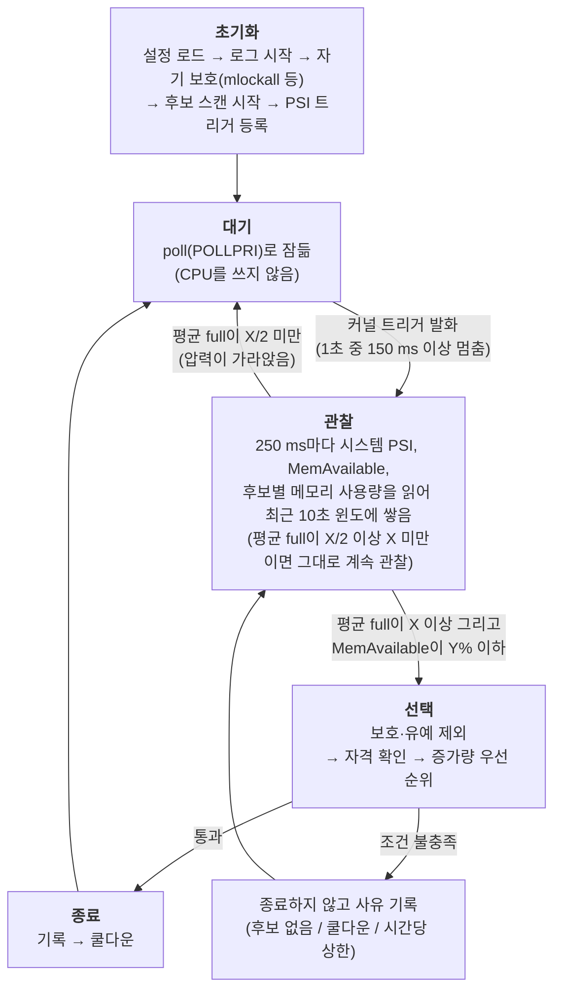

# Thrash Guard 데몬 설계

> 데몬이 **언제 개입하고, 누구를 종료하고, 어떻게 종료하는지**의 핵심을 설명한다. 목적은 [plan.md](../plan.md), 검증은 [validation/overview.md](../validation/overview.md)에 있다.
> 수치는 모두 측정 전 임시값이며, 확인하지 못한 것은 "미확인", 추론은 "추론"으로 표시한다.

## 1. 한눈에 보기

데몬은 평소에 잠들어 있다가 커널이 "메모리 압력이 높다"고 알려 주면 깨어난다. 압력이 정말 지속되는지 짧게 지켜보고,
지속되면 메모리를 가장 많이 점유한 쪽을 골라 종료한다.

## 2. 언제 개입하나

| 입력 | 출처 | 역할 |
|---|---|---|
| 시스템 PSI `full` | `/proc/pressure/memory`의 `total`(누적 stall 시간) 차분 | 깨우기와 지속 판단 |
| `MemAvailable` | `/proc/meminfo` | 여유 메모리 보호선: 압력이 높아도 메모리가 넉넉하면 종료하지 않음 |

- `full`은 "일하고 있거나 일하려는 모든 작업이 메모리 때문에 동시에 멈춘 시간의 비율"이다. 스래싱에서는 모든 작업이 같은 페이지를 디스크에서 다시 읽으려고 줄을 서므로 크게 오른다.
  `some`(일부 작업이라도 멈춤)은 정상 버스트에서도 쉽게 올라 임계값의 근거가 없어 쓰지 않는다.
- **두 단계 확인**: 커널 트리거가 데몬을 깨우고, 깨어난 뒤에는 **윈도**(최근 10초의 샘플 모음)의 평균으로 일시 버스트와 지속되는 스래싱을 구분한다.
  평균은 샘플 수가 아니라 실제 경과 시간으로 나눠 데몬이 밀려도 비율이 틀어지지 않는다. 짧은 stall을 놓치는 `avg10`은 쓰지 않고 `total`의 증가분으로 직접 계산한다.
- **한계**: 최소 감지 지연은 약 10초(트리거 이전 기록이 없어 윈도가 차야 함). 짧지만 센 버스트(예: 3초간 60%)는 평균이 임계를 넘어 오탐할 수 있다.
  필수 프로세스가 보호받아 계속 돌면 시스템 `full`이 낮게 유지되어 워크로드만 스래싱하는 상황을 놓칠 수 있다(추론). 검증에서 확인하고, 놓치면 대상 구역의 `full`을 함께 본다.

## 3. 누구를 종료하나

**압력은 "시스템이 위험하다"를 알리는 데만 쓰고, 희생자는 메모리 사용량으로 고른다.** PSI는 메모리 때문에 *멈춘* 쪽을 재므로 원인이 아니라 피해자를 가리킬 수 있다.
메모리를 크게 쥐고 잠든 프로세스는 자기 PSI가 0이다. 비슷한 도구(oomd, earlyoom, nohang)도 감지는 압력·여유량으로, 선택은 크기로 한다.

종료 단위는 cgroup이고, 후보는 `target_parent`의 직계 자식이다.

1. **제외**: 보호된 cgroup([design/protection.md](protection.md)), 시작 직후 유예 중, 윈도가 덜 찬 후보.
2. **자격**: 최근 10초 최대 사용량(`anon + file`)이 전체 메모리의 10% 이상이어야 한다. 미달이면 종료하지 않고 `no_culprit`으로 기록한다.
3. **순위**: 윈도 안 증가량(최대 사용량 − 첫 샘플의 사용량)이 전체의 1% 이상인 후보가 있으면 **증가량이 가장 큰 것**, 없으면 **최대 사용량이 가장 큰 것**. 동률은 앞 번호.

천천히 계속 늘어나는 프로세스(누수형)는 한꺼번에 키운 뒤 가만히 있는 프로세스보다 먼저 선택된다. 윈도 안에서 한꺼번에 늘어난 프로세스는 증가량이 크므로 역시 선택된다.

**한계**: 데몬은 프로세스의 의도를 알 수 없다. 시작하며 늘어나는 중인 정상 앱은 선택될 수 있고(유예와 보호로 완화), 이미 많이 쥔 채 가만히 있는 프로세스는 증가 중인 후보가 없을 때만 선택된다.
지켜야 할 앱은 보호 설정으로 지정해야 한다. 후보별 사용량과 증가량은 모두 로그에 남겨 규칙을 사후에 점검한다. 근거와 예시는 [design/victim-selection.md](victim-selection.md)에 있다.

## 4. 어떻게 종료하나

MVP는 `cgroup_kill` 한 가지다. 선택한 cgroup의 `cgroup.kill`에 `1`을 쓴다(희생자 선택은 3절).

`cgroup.kill`은 같은 SIGKILL을 cgroup 안의 모든 프로세스에 **커널이 한꺼번에 전달**하는 기능이다(리눅스 5.14 이상). pid 목록을 읽지 않아 스래싱 중에도 파일 쓰기 한 번으로 끝나고,
목록을 읽은 뒤 새로 생긴 프로세스를 놓치거나 pid가 재사용되어 엉뚱한 프로세스를 죽일 위험이 없다.

**구현 규칙**: 종료 함수(`src/daemon/killer`)는 `target_parent`를 연 디렉터리 핸들과 cgroup 이름을 받아, 이름을 검증한 뒤(`/` 포함, `.`, `..`, 빈 이름, 용량 초과는 거부)
그 핸들 기준 `openat`으로 `<이름>/cgroup.kill`을 열어 `1`을 쓴다. dry-run은 호출자(이벤트 루프)가 처리하고 종료 함수는 모른다. 실패 이유는 음수 errno로 구분한다
(`-ENOENT` cgroup이 이미 없음, `-ENOTSUP` 이 커널에 `cgroup.kill` 없음, `-EACCES` 권한 없음, `-EINVAL` 잘못된 이름). 반환 성공은 "신호를 전달했다"까지이고 종료 확인은 PSI가 가라앉는지로 한다.

**`oom_kill`은 MVP에서 뺀다**: `/proc/sysrq-trigger`에 `f`를 써 커널 OOM killer를 실행하는 방식인데, 커널이 시스템 전체에서 고르므로 `target_parent` 아래만 종료한다는 안전 원칙과 맞지 않고
3절의 선택 규칙도 쓰지 못하며, 세부 동작도 확인하지 못했다. 필수와 문제 프로세스가 한 cgroup에 섞인 경우의 보완책은 후속(M5)에서 범위 문제와 함께 설계한다.

**종료와 CPU**: 두 방식 모두 "파일에 쓴다"는 것은 시스템 콜이다. 데몬 스레드가 CPU를 받아 `write()`를 실행하면 커널이 그 호출 안에서 대상에 SIGKILL을 표시하고 깨운다(별도 커널 프로세스가 파일을 감시하는 구조가 아니다).
실제로 사라지는 것은 대상이 CPU를 받아 종료 처리를 마친 뒤이고, 디스크 입출력을 기다리는 상태의 대상은 그 대기가 끝나야 한다. 그래서 CPU가 포화되면 `write()` 시작과 대상의 종료가 모두 늦어질 수 있다.
이 프로젝트가 겨냥한 스래싱은 CPU보다 메모리·입출력 병목이고, 그쪽은 `mlockall`로 대비한다. CPU 경쟁은 보호하지 못하는 **한계**이며, 서비스 파일(M3-8)에 `CPUWeight` 상향을 넣고 M4에서 CPU 부하를 섞어 확인한다.

## 5. 안전장치

- **dry-run이 기본**이다. 판단만 기록하고 종료하지 않으며, 가상 종료로 쿨다운과 상한을 소모해 실제 모드와 같은 동작을 보여 준다. 끄는 것은 CLI `--no-dry-run`만 가능하다.
- 시작 직후 **유예**, 종료 후 **쿨다운**, **시간당 종료 상한**.
- 설정 파일에 모르는 키가 있으면 시작을 거부한다(오타로 안전장치가 꺼지는 것을 막기 위해). 우선순위는 기본값, 설정 파일, CLI 순이다.
- 같은 사유의 건너뜀은 관찰 한 번에 한 번만 알려 로그가 넘치지 않게 한다.

## 6. 상세 설계 문서

| 문서 | 내용 |
|---|---|
| [design/victim-selection.md](victim-selection.md) | 희생자 선택(왜 압력이 아니라 사용량인가, 규칙, 예시, 대안, 한계) |
| [design/protection.md](protection.md) | 보호 설계: 필수 프로세스 보호(종료·회수), 데몬 자기 보호(`mlockall` 등), 후보 스캔 구조 |
| [design/log-ringbuffer.md](log-ringbuffer.md) | 로그 링버퍼와 기록 스레드(락 없는 구조, eventfd) |
| [validation/measurement.md](../validation/measurement.md) | 측정 정의와 규칙 |

## 7. 코드 구성과 상태

| 모듈 | 역할 | 상태 |
|---|---|---|
| `src/common/procfs`, `selfprot`, `fmt` | `/proc`·cgroup 파서, 자기 보호, 할당 없는 문자열 조립 | 완료 |
| `src/sampler` | 실험용 수집기 `tg-sampler`(UDP로 VM 밖에 전송) | 완료 |
| `src/daemon/config` | `key=value` 설정, 검증 | 완료 |
| `src/daemon/policy` | 유예, 쿨다운, 시간당 상한 | 완료 |
| `src/daemon/targets`, `scanner` | 후보 cgroup 표, 스캔 스레드 | 완료 (보호 제외 규칙 추가 예정) |
| `src/daemon/log` | 링버퍼 로그, 기록 스레드 | 완료 |
| `src/daemon/killer` | 종료 실행(`cgroup.kill` 쓰기) | 완료 (이벤트 루프에 아직 연결되지 않음) |
| `src/daemon/judge` | 판단(순수 함수): 시스템 PSI 평균, `MemAvailable` 보호선, 사용량·증가량 선택 | 완료 (이벤트 루프에 아직 연결되지 않음) |
| `src/daemon/main` | CLI, 설정 로드 | 이벤트 루프 미구현 |

## 8. 초기값과 목표 수치 (모두 측정 전 임시값)

| 항목 | 값 | 근거 |
|---|---|---|
| 트리거 | 1초 중 150 ms | 커널 문서 예시 수준. 깨우기용이라 틀려도 비용이 작음 |
| 지속 판단 임계 X | 40% | 임시 초기값, **미검증**. 참고용 M1 기록의 스래싱 `full` 53~77%보다 낮고 systemd-oomd(avg10 60%)보다 민감하게 잡았다. 효과 검증의 정상 버스트·폭주 실험으로 조정한다 |
| 윈도 N, 샘플 간격 | 10초, 250 ms (40칸, 최대 256칸) | 근거 약함 |
| 여유 메모리 보호선 Y (`mem_avail_pct`) | `MemAvailable` ≤ 10% | earlyoom 기본값(외부 글), 근거가 약함 |
| 관찰 종료 | 평균 full < X/2 (20%) | 근거 없음 |
| 후보 자격 하한(`min_size_pct`), 증가 인정 최소량(`min_growth_pct`) | 전체의 10%, 1% | 근거 없음 |
| 유예, 쿨다운, 시간당 상한 | 30초, 60초, 3회 | 안전 여유값 |
| 로그 링버퍼 | 16 KiB (64줄) | |
| **목표**: 유휴 메모리, 유휴 CPU | `VmRSS` 2 MiB 이하, 측정 오차 수준 | 길벗의 메모리 예산 여유가 3 MiB였음 |

검증 결과로 재보정하며, 보정에 쓴 실행과 평가에 쓴 실행은 구분한다.

## 9. 기술 선택과 미결 사항

- 언어는 **C**(C11)다. 핵심 경로가 시스템 콜 몇 개이고 런타임과 GC가 없어 무할당을 검증하기 쉽다.
- 대상 환경은 cgroup v2, PSI 활성, `cgroup.kill` 지원(리눅스 5.14 이상), root 권한이다. PSI 트리거 등록은 root가 필요한 것을 확인했다([lab/environment.md](../lab/environment.md)).
- 빌드는 단일 `Makefile`, 테스트는 자체 최소 assert 헤더와 `/proc` 파일 fixture, 정적 링크 libc는 glibc와 musl을 모두 지원하고 실측으로 기본값을 고른다.
- **미결**: 컨테이너가 없는 일반 서버의 기본 `target_parent`, PSI 트리거 등록 실패 시 동작(제안: 시작 거부).

## 10. 참고 자료

[PSI](https://docs.kernel.org/accounting/psi.html), [Control Group v2](https://docs.kernel.org/admin-guide/cgroup-v2.html),
[Multi-Gen LRU](https://docs.kernel.org/admin-guide/mm/multigen_lru.html), [systemd-oomd](https://www.freedesktop.org/software/systemd/man/latest/systemd-oomd.service.html),
[Facebook oomd 설계 글](https://engineering.fb.com/2018/07/19/production-engineering/oomd/), [facebookincubator/oomd](https://github.com/facebookincubator/oomd)(GPL-2.0, 코드를 가져오지 않고 아이디어만 참고),
[earlyoom](https://github.com/rfjakob/earlyoom), [nohang](https://github.com/hakavlad/nohang). 선행 도구 조사는 [reports/related-work.md](../reports/related-work.md).
