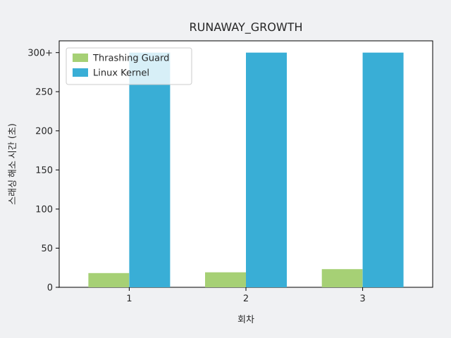
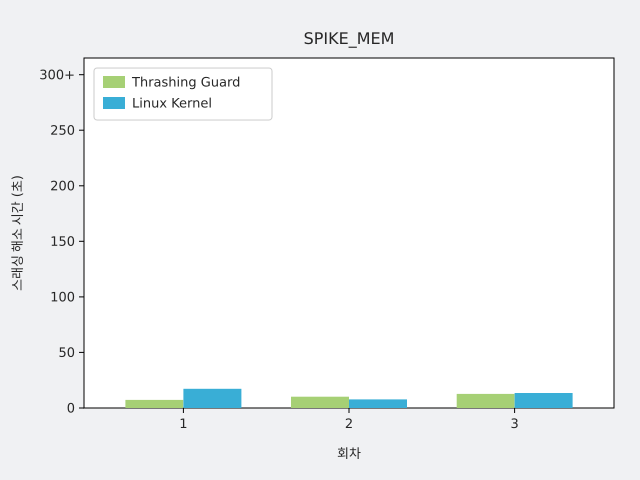

# M4 효과 검증 보고서

> 데몬이 켜지면 멈춘 시스템이 더 빨리 풀리는지, 필수 프로세스가 지켜지는지, 정상 버스트를 오탐하지 않는지를 1 GiB VM에서 측정한 결과다.
> 설계와 정의는 [validation/overview.md](../validation/overview.md), [validation/measurement.md](../validation/measurement.md)에 있다. 요약은 `results/m4/2026-11-13/`의 `summary.md`, `summary.json`이다.
> 모든 값은 **합성 부하를 쓴 VM 실험에서의 값**이고, 부하·조건마다 3회씩의 관찰이다. 합격 기준은 임시값이다.

## 1. 요약

| 항목 | 주장 | 결과 | 근거 |
|---|---|---|---|
| 해소 시간 (RUNAWAY_GROWTH) | V2 | 합격 | 켜짐 3회 모두 18.2~23.2초에 해소(중앙값 19.2초), dry-run은 3회 모두 5분 안에 풀리지 않음 |
| 해소 시간 (SPIKE_MEM) | V2 | 합격(차이 작음) | 켜짐 7.3~12.7초(중앙값 10.2초), dry-run 7.7~17.3초(중앙값 13.5초) |
| E 생존 | V3 | 합격 | 켜짐 6회 모두 보호된 E가 종료되지 않고 active |
| 정상 버스트 | V4 | 합격 | 3회(각 300초, 20사이클) 모두 종료 결정 0건 |

RUNAWAY_GROWTH에서는 효과가 뚜렷하다. SPIKE_MEM에서는 이 환경의 커널 OOM killer도 10초 안팎에 부하를 종료하므로 켜짐의 이점이 3초 남짓으로 작다.

## 2. 조건

- 환경: 1 GiB VM, swap 없음, 디스크 처리량 약 10.9 MB/s, 배경 `mlock` 43 MiB. 필수 프로세스 E(응답 서버, `oom_score_adj=-1000`)와 부하 하나를 별도 cgroup(`tg-canary`, `tg-load`)으로 실행한다.
- 부하: `RUNAWAY_GROWTH`(익명 메모리를 초당 4 MiB씩 650 MiB까지), `SPIKE_MEM`(650 MiB를 한 번에), 정상 버스트(400 MiB를 5초 유지, 10초 쉬기, 300초).
- 비교: 데몬 켜짐(실제 종료)과 dry-run(판단만 기록, 데몬 꺼짐 대용). 폭주 2종은 각 3회, 정상 버스트는 dry-run 3회로 15회다.
- 측정: T0는 VM 밖 SSH 프로브가 3번 연속 실패한 첫 프로브의 시작, 해소는 이후 5번 연속 성공이다. 해소 시간은 T0부터 해소까지이며 5분(300초) 안에 풀리지 않으면 미해소다. PSI 기준은 보조 기록이다.
- **SPIKE_MEM의 투입 방식**: 데몬이 시작될 때 이미 있던 cgroup은 시작 직후 유예(30초)를 받지 않는다. 장애 때처럼 "이미 떠 있던 프로세스가 갑자기 커지는" 조건으로 하려고, `tg-load` 서비스를 데몬이 뜨기 전에 대기 상태로 만들어 두고 기준 구간 뒤에 신호 파일로 급증시켰다. 이 방식으로 3회씩 본 실행했다.

## 3. 결과

### 3.1 해소 시간 (V2)

| 부하 | 조건 | 해소 시간(초) | 중앙값 | T0→데몬 첫 결정(초) | 종료→해소(초) |
|---|---|---|---|---|---|
| RUNAWAY_GROWTH | 켜짐 | 18.2, 19.2, 23.2 | 19.2 | 11.0, 11.4, 15.9 | 7.2~7.8 |
| RUNAWAY_GROWTH | dry-run | 미해소, 미해소, 미해소 | 미해소 | 10.2, 10.7, 11.2(가상 결정) | - |
| SPIKE_MEM | 켜짐 | 7.3, 10.2, 12.7 | 10.2 | 0.4, 4.1, 6.7 | 6.0~6.9 |
| SPIKE_MEM | dry-run | 17.3, 7.7, 13.5 | 13.5 | 1.4(1회만 결정) | - |

- **RUNAWAY_GROWTH**: 스래싱이 부하 시작 약 150초 뒤에 시작된다(T0 156.9~163.1초). 켜짐은 T0 후 11~16초에 데몬이 `path=mem`으로 부하를 종료했고 7초 안에 풀렸다. dry-run에서는 같은 시점에 가상 결정만 기록됐고 커널 OOM killer는 T0 후 300초 동안 개입하지 않았다(미해소 3회). 데몬이 커널보다 먼저 개입한 비율은 켜짐 3/3이다. dry-run 첫 실행에서는 커널 OOM이 부하 시작 후 약 662초(T0 후 약 505초)에 나왔다.
- **SPIKE_MEM**: T0는 부하 시작 0.6~5.5초에 잡혔다. 켜짐 3회는 모두 데몬이 먼저 종료했고(부하 시작 후 5.9~8.2초, `path=io`) 커널 OOM은 0건이었다. dry-run 3회는 모두 커널 OOM이 7.0~11.3초에 부하를 종료해 해소했다. 켜짐과 dry-run의 중앙값 차이는 3.3초다.

### 3.2 필수 프로세스 E 생존 (V3)

켜짐 6회(RUNAWAY_GROWTH 3, SPIKE_MEM 3) 모두 종료된 대상은 부하 cgroup 하나뿐이었고, 종료 시점과 실행 종료 시점에 `tg-canary`는 active였다. 합불에 쓰지 않는 응답 기록은 아래와 같다.

| 부하 | 조건 | E 카나리 최대 무응답 중앙값(초) | 범위(초) | SSH 최대 무응답 중앙값(초) |
|---|---|---|---|---|
| RUNAWAY_GROWTH | 켜짐 | 1.6 | 1.6~2.3 | 16.2 |
| RUNAWAY_GROWTH | dry-run | 17.7 | 7.1~67.7 | 300.0 |
| SPIKE_MEM | 켜짐 | 3.3 | 2.4~4.1 | 10.1 |
| SPIKE_MEM | dry-run | 3.4 | 2.3~5.2 | 13.5 |

RUNAWAY_GROWTH에서는 켜짐이 E의 멈춤도 크게 줄인다. SPIKE_MEM에서는 차이가 없다.

### 3.3 정상 버스트 (V4)

400 MiB 버스트 20사이클을 3회 관찰했다. 1초 `full` 최대는 31~90%, 10초 평균 최대는 4~21%였고 가용 메모리 최저는 66~83 MiB였다. SSH가 잠깐 막히는 구간은 있었지만(최대 무응답 2.0~4.5초) 종료 결정은 0건이었다. 판단 로그에는 `reason=mem_available`(가용 메모리 조건 미충족)과 `no_candidate`가 한 번씩 남았다. 압력은 데몬의 종료 임계를 넘는 순간이 있었지만 가용 메모리가 남아 있어 종료 조건이 충족되지 않았다.

### 3.4 선택과 해소 경로 (V5, 기록)

종료된 대상은 켜짐 6회 모두 `tg-load.service`였다. 후보가 부하 하나뿐이라 선택 규칙이 정상과 폭주를 구별하는지는 확인하지 못했다.

## 4. 해석과 한계

- **RUNAWAY_GROWTH는 데몬의 가치가 분명한 사례다.** 커널은 가용 메모리가 바닥난 채 5분 이상 지속되는 정지를 풀지 않았고, 데몬은 T0 후 11~16초에 종료해 풀었다.
- **SPIKE_MEM은 이 구성에서 커널도 빠르다.** 1 GiB에 650 MiB를 한 번에 올리면 커널 OOM이 7~11초에 부하를 종료한다. 켜짐의 이점은 3초 남짓이고, 3회 관찰로는 중앙값 비교의 합격이 우연일 수 있다. 같은 조건으로 켜짐을 한 번 돌렸던 스모크에서는 커널 OOM이 데몬보다 먼저 8.4초에 해소했다. 그래서 "데몬이 항상 먼저"라고 말할 수는 없다.
- **데몬 유예가 급증형의 켜짐 해소를 늦춘다.** 같은 SPIKE_MEM을 새로 시작한 서비스로 투입한 첫 6회에서는 데몬의 첫 결정이 약 33초(유예 30초 포함)였다. 6회 중 5회는 커널 OOM이 먼저 해소했고, 켜짐 3회 중 데몬이 종료한 것은 1회뿐이었다(해소 중앙값 켜짐 14.2초, dry-run 14.3초, 최대 85.2초). 막 시작한 프로세스가 급증하면 유예 때문에 데몬이 개입하지 못한다는 뜻이며, 이는 정상 앱 오종료를 막기 위한 설계 대가다.
- **dry-run을 꺼짐 대용으로 쓴 한계.** 데몬 없는 실행과 직접 비교하지 않았다.
- **켜짐 해소가 5분을 넘길 확률은 추정하지 못한다.** 이번 켜짐 6회, M3의 켜짐 15회, M4 스모크 1회에서 5분을 넘긴 적은 없지만 표본이 작다.
- **측정 정의의 임시값.** SSH 연속 실패 3회, 연속 성공 5회, 해소 시간 60초 기준, 중앙값 비교 규칙은 임시이며 본 실행의 PSI 보조 기록과 6개 실행에서 T0가 어긋났다(`summary.md` 주의할 실행).
- **V1.** RUNAWAY_GROWTH에서는 dry-run으로 SSH 불가와 압력이 지속되고 커널 OOM이 늦거나 없음을 확인했다. SPIKE_MEM에서는 커널이 10초 안팎에 종료해 재현되지 않았다.
- **이번 검증에서 하지 못한 것.** 정상 앱과 폭주 중 무엇을 고르는지(V5), 폭주형 반복 할당·해제(`BURST_MEM`), 파일 경쟁 부하(`FILE_THRASH`), 실제 클라우드 디스크 조건, swap이 있는 환경.

## 5. 후속

- 급증형의 유예를 줄인 조건과 켜짐 대 dry-run 차이의 감도 비교(후보 유예 30초가 감지 지연을 지배한다).
- dry-run과 데몬 없는 실행의 직접 비교.
- SSH 연속 횟수와 판정 규칙의 재보정, 유효 실행 수 확대.
- 처리량 상한 외 실제 인스턴스 조건에서의 재현.
