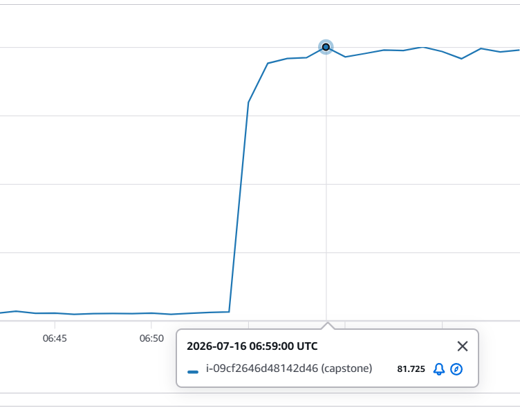
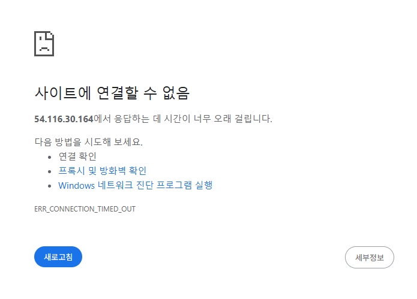

# Thrash Guard

메모리가 부족해 서버가 멈췄는데도 커널이 프로세스를 종료하지 않는 상태(스래싱 livelock)를 감지하고, 커널보다 먼저 원인 프로세스를 종료하는 데몬이다.

## 1. 배경

### 실제로 일어난 일
캡스톤 프로젝트의 백엔드 서버를 운영하던 중 SSH 접속조차 안되는 응답 불능 장애가 발생했다. 당시 상황은 아래와 같다.

- 메모리가 1GB뿐인 AWS EC2 리눅스 서버를 사용했다.
- 서버에 띄워놨던 스프링 애플리케이션 뿐만 아니라 SSM Agent, CloudWatch Agent, sshd 같은 상주 데몬 또한 멈춰 장애 당시 SSH 접속과 메트릭 수집이 불가능했다.
- 가용 메모리가 0~11 MiB를 오갔고, 리눅스 커널의 OOM killer는 한 번도 발동하지 않았다.
- CPU 사용률이 급증해 장애 내내 80%에 머물렀다. 커널이 회수 가능한 페이지를 탐색하는 데 쓰인 것으로 보인다. 

*그림 1-2 장애 구간의 CPU 사용률(CloudWatch)*

*그림 1-3 장애 중 서비스 주소로 접속한 화면*

### 원인은 스래싱
리눅스 커널은 통상적으로 가용 메모리가 부족한 상황에서 OOM Killer를 발동해 메모리 점유율이 높은 프로세스를 강제 종료시킨다. 그렇다면 왜 OOM Killer가 발동하지 않은 것인가?

- 리눅스 커널은 메모리가 부족해도 조금이라도 메모리 회수에 성공하면 OOM Killer를 발동시키는 대신 회수를 다시 시도한다.
- 당시 서버의 디스크에는 swap 공간이 없어, 익명 페이지를 내보낼 곳이 없었다. 회수할 수 있는 메모리는 디스크에 원본이 있는 페이지 캐시뿐이었다.
- 페이지 캐시를 조금이나마 회수하는 데 성공하여 OOM Killer는 발동하지 않는다.
- 쫓겨난 페이지는 곧바로 필요해 디스크에 다시 읽어오고, 다시 쫓겨나는 일이 반복된다.
- 프로세스는 실행 시간 대부분을 쫓겨난 페이지를 기다리는 데 쓴다. 이는 메모리가 과잉 할당된 상황에서 리눅스의 OOM Killer가 너무 늦게 작동하여 시스템이 무기한 멈추는 리눅스의 알려진 버그이다.

그래서 커널의 OOM-Killer 발동이 늦어 시스템이 무기한 멈추는 상황을 방지하기 위해 User space에서 스래싱 상황을 감지해 메모리 압박 프로세스를 강제 종료하는 데몬을 만들게 됐다.

## 2. 문제 재현

### PSI (Pressure Stall Information)
PSI는 커널이 제공하는 "압박 측정치"이다. 프로세스가 메모리 부족, 디스크 I/O 대기 등으로 일을 못하고 기다린 시간이 전체 시간 중 몇 %인지를 커널이 알려 주는 지표다.

| 파일 | 뜻 |
|---|---|
| `/proc/pressure/memory` | 메모리가 모자라 기다린 시간 |
| `/proc/pressure/io` | 디스크 I/O를 기다린 시간 |
| `/proc/pressure/cpu` | CPU를 못 받아 기다린 시간 |

장애 상황을 재현하기 위해 로컬 노트북에 메모리가 1GB인 리눅스 VM 환경을 구축하여 컨테이너의 메모리 점유율을 조금씩 키웠다.
10초마다 SSH 접속을 시도하여 접속이 되지 않을 때를 시스템이 멈춘 상황으로 보았다. 재현 실험 결과는 다음과 같다.

- 가용 메모리가 0~3 MiB로 바닥나는 시점에 SSH 로그인이 막히기 시작한다. 정상 부하 구간의 가용 메모리 최소는 약 40 MiB이다.
- 정지 초기에는 memory PSI가 오르지만 굳어진 뒤에는 평균 4~9%로 내려가고 IO PSI 93~95%로 이어진다.
- 표본은 5회를 5분동안 실행한 결과 OOM Killer는 한 번도 발동하지 않았다.

## 3. 스래싱 탐지

실행 가능한 프로세스들이 메모리 압박으로 인해 1초 중 150ms 이상 정체됐을 때 스래싱이 시작됐다고 보고 데몬이 깨어나도록 이벤트 기반 트리거를 등록했다. 평소에 데몬은 CPU를 쓰지 않는다. 

## 3. 무엇을 죽일 것인가

종료 단위는 cgroup이다. `cgroup.kill`을 쓰면 하위 프로세스까지 한 번에 종료된다. 종료 직전에 cgroup identity를 다시 확인해, 같은 이름으로 새로 만들어진 cgroup을 죽이지 않도록 했다.

후보는 허용 목록(`target_match`)에 든 cgroup 중에서 고른다. 최근 윈도에서 메모리 사용량이 많이 늘어난 것을 먼저, 그다음 크기 순으로 보고, 최소 사용량에 못 미치는 것은 제외한다. 윈도는 샘플 간격이 흔들리거나 비어도 비율이 틀어지지 않도록 시간 기준으로 계산한다.

오종료를 막는 장치로 시작 유예, 쿨다운, 시간당 종료 상한, 후보 표가 낡았을 때 종료하지 않는 검사를 두었다. 기본 모드는 dry-run이고, 실제 종료 모드는 시작 시 환경 점검에 실패하면 시작하지 않는다.

## 4. 필수 프로세스 보호

종료에서 빼는 것과 메모리에서 쫓겨나지 않게 하는 것을 나누어 실험했다.

### 4.1 종료 제외
`oom_score_adj=-1000`인 프로세스가 하위에 하나라도 있으면 그 cgroup은 후보에서 뺀다. 확인하지 못하면 보호된 것으로 본다. 보호 없는 대조군에서는 3/3회 `prot`이 종료됐고, 보호를 건 처치군에서는 유효한 2회 모두 `hog`가 종료되고 `prot`은 제외되어 살아남았다. 처치군 1회는 커널 OOM이 먼저 종료해 분석에서 뺐다(`D_protect_*`).

### 4.2 `memory.low`
`ssh.service`, `system.slice`, `user.slice`에 각 32M을 걸었다. 로그인 불가 시간은 보호 없음 333·315·198초, 있음 359·484·305초로 줄지 않았고, `memory.events`의 `low`가 3.7만~57만 회 올라 보호가 계속 깨졌다(`E_memorylow_*`). swap 없이 익명 메모리가 가득하면 회수할 비보호 메모리가 없기 때문으로 해석한다. 그래서 기본 요구에서 빼고 선택 설정으로 두었다.

### 4.3 데몬 자신
`mlockall`, 스택·스레드 사전 접근, glibc arena 1개 제한, 초기화 이후 무할당으로 데몬이 스래싱 중에도 멈추지 않게 했다. 로그는 락 없는 링버퍼로 남겨 핵심 경로가 로그 때문에 기다리지 않는다. 무할당은 테스트 실행 파일이 `malloc` 계열을 직접 정의해 libc 내부 호출까지 세는 방식으로 검증했고, 핵심 경로에 일부러 할당을 넣으면 실패하는 것까지 확인했다.

스래싱 중 23회 실행(틱 11,757회)에서 지연된 틱은 0회, 최대 지연은 15 ms, 샘플 읽기 실패는 0회였다. 다만 `mlock`을 끈 대조군이 없어 이 결과를 `mlockall` 덕분이라고 단정하지는 않는다.

## 5. 효과 검증

Windows용 QEMU(WHPX) VM(1 GiB, 2 vCPU, swap 없음, 디스크 처리량 10.9 MB/s 제한)에서 합성 부하를 주고 데몬을 판단만 하는 상태(dry-run)와 실제 종료 상태로 번갈아 실행했다. 판정 기준과 제외 기준은 실행 전에 적어 두었다.

| 각 3회 | dry-run | 실제 종료 |
|---|---|---|
| 가용 메모리 30 MiB 미만 지속 | 376, 309, 302초 (부하 시간 420초에서 마침) | 21, 13, 21초 |
| 로그인 불가 | 378, 313, 310초 | 19, 16, 0초 |
| 커널 OOM killer 개입 | 0/3 | 0/3 |

최종 규칙으로 다시 돌린 실제 종료 2회도 22초 안에 종료했고, 두 번 모두 io 경로로 결정했다(`H_iopath_*`). 100 IOPS 조건에서는 9회 중 1회를 커널 OOM이 먼저 종료한 사례도 있었다.

한계: 각 2~3회 표본이고 VM 한 종류다. 처리량 상한은 일정해서 크레딧 소진 과정은 반영하지 않았고, dry-run이 데몬을 완전히 끈 것과 같다고 말할 수 없다. 정상 버스트 오탐과 다른 폭주 유형은 확인하지 못했다.
