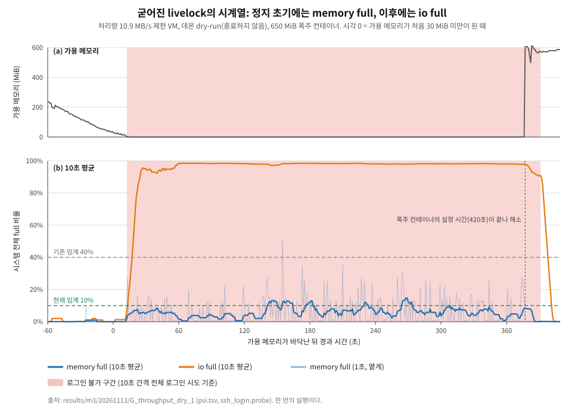
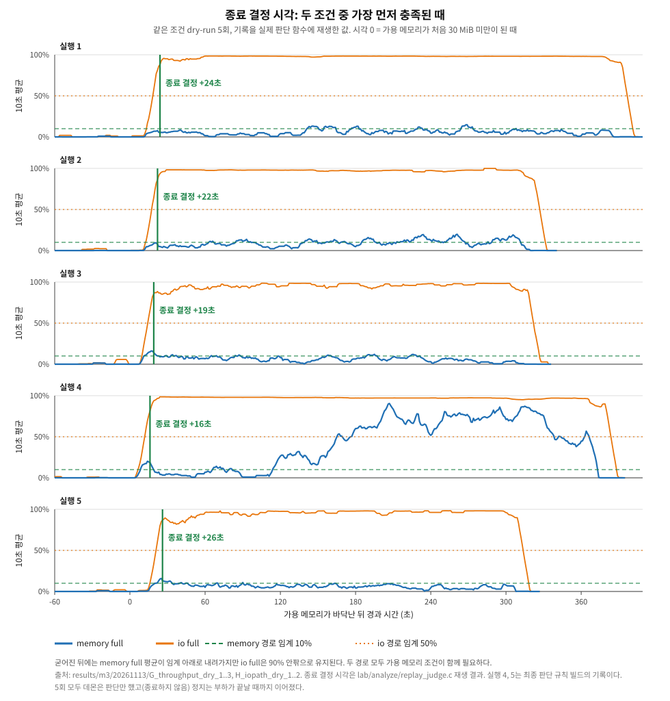

# 포트폴리오 구성안

> Thrash Guard를 포트폴리오로 풀어 쓰기 위한 구성안이다. 절마다 전하려는 메시지, 들어갈 내용, 근거 자료의 위치, 그림과 표를 정리한다. 본문은 아직 쓰지 않았다.
> 숫자는 이 저장소의 실측 기록에서 가져오고, 경로는 `results/m3/20261113/` 기준이다.

## 중심 줄기

**스래싱 때 시스템에서 일어나는 일을 시계열로 측정하고, 측정값에 맞춰 감지와 종료 규칙을 설계했다.** 설계 결정마다 어떤 측정이 근거인지를 보여 준다. 개발 중의 시행착오 이력은 쓰지 않고 최종 설계와 그 근거만 쓴다.

## 쓰는 원칙

- `[측정]`은 이 저장소의 실험 기록이 근거, `[추정]`은 추론, `[전달]`은 다른 작업 세션에서 전달받아 직접 확인하지 못한 값이다.
- 주장은 근거가 있는 범위까지만 쓴다. 데몬을 끈 대조군 반복(M4) 전에는 "더 빨리 해소한다"를 일반 주장으로 쓰지 않는다.
- 한계는 각 절 끝에 쓰고 마지막 절에서 한 번 더 모은다.

## 한눈에 보기

| 절 | 전하려는 메시지 | 상태 |
|---|---|---|
| 1. 문제: livelock이란, 언제 생기는가 | OOM killer가 개입하지 않고 서버가 멈추는 장애에서 출발했다 | 준비됨 |
| 2. 이벤트 기반 감지 (PSI 트리거) | 커널 이벤트로 깨우고, 무엇을 볼지는 시계열 측정이 정했다 | 준비됨, 그림 2장 완료 |
| 3. 무엇을 죽일 것인가 | 판단 규칙과 안전장치를 근거로 설계했다 | 준비됨 |
| 4. 필수 프로세스 보호 (데몬 자신 포함) | 보호를 두 층으로 나누고 한쪽은 효과가 없음을 확인했다 | 준비됨, `mlock` 대조군 없음 |
| 5. 효과 검증 | 켬/끔을 같은 조건에서 비교하고 한계를 함께 쓴다 | 일부, 정상 버스트와 폭주 3종은 M4 |

---

## 1. 문제: livelock이란, 언제 생기는가

**메시지**: 메모리가 모자랄 때 서버가 "죽는" 것이 아니라 "멈춰서 안 죽는" 경우가 있고, 이쪽이 더 위험하다.

**들어갈 내용**
- OOM kill과 livelock의 차이: OOM killer는 메모리 할당이 실패해야 동작하지만, 스래싱은 할당이 느릴 뿐 실패하지 않아 몇 분~몇 시간 개입하지 않을 수 있다.
- 발생 조건: swap 없음, 회수할 수 없는 익명 메모리가 대부분, 쫓겨난 코드·캐시 페이지를 느린 디스크에서 다시 읽는 반복.
- 출발점이 된 실제 장애: t3.micro, 약 27시간 응답 불능, OOM kill 없음. `[전달]` 읽기가 인스턴스 EBS 기준 대역폭(약 10.9 MB/s)에 묶여 있었다. 실험도 디스크 처리량을 이 값으로 제한해 같은 조건을 만든다.

**그림/표**: 그림 1-1 OOM kill 경로와 livelock 경로 비교 개념도(제작 필요), 표 1-1 장애 조건과 실험 조건 대응.

**근거**: `docs/plan.md`, `docs/lab/environment.md` 5.6~5.7절

---

## 2. 이벤트 기반 감지 (PSI 트리거)

**메시지**: 평소에는 자다가 커널 이벤트로 깨어나고, 깨어난 뒤 무엇을 어떻게 볼지는 스래싱의 시계열을 재서 정했다.

### 2.1 트리거 → 관찰 → 종료 흐름
- PSI 트리거(`/proc/pressure/memory`에 1초 중 150 ms 등록, `poll`의 `POLLPRI`)가 깨운다. 평소에는 `poll`로 잔다.
- 깨어나면 관찰을 시작해 250 ms마다 샘플을 모으고, 최근 10초 윈도 평균과 가용 메모리로 판단한 뒤 후보를 골라 `cgroup.kill`을 쓴다.
- **그림 2-1**: 흐름 다이어그램(`docs/design/overview.md` 기반, 제작 필요)

### 2.2 평소 비용
- 이벤트 루프는 단일 `poll`(신호 fd + PSI 트리거 fd), 타이머 fd 없음.
- `[측정]` 유휴 시 `VmRSS` 1.4 MiB(전부 `mlock`), 스레드 3개, 기록 스레드의 유휴 깨어남 3초 동안 0회(WSL).
- **미측정**: 평소 CPU 사용률. 쓰려면 유휴 구간의 CPU 시간을 한 번 재서 넣는다.

### 2.3 시계열 측정이 정한 설계 (이 절의 중심)

처리량 10.9 MB/s로 제한한 VM에서 폭주 컨테이너를 키우고, 데몬은 판단만 하는 상태로 두어 정지의 자연 경과를 1초 간격으로 기록했다(`G_throughput_dry_1`, 약 6분 정지).

| 측정에서 읽은 것 `[측정]` | 설계에 준 결정 |
|---|---|
| 가용 메모리가 0~3 MiB로 바닥난 시점에 SSH 로그인이 막히기 시작한다. 정상 부하 구간의 가용 메모리 최소는 약 40 MiB | 종료 조건에 **가용 메모리 조건**을 둔다. 메모리가 충분한 대용량 I/O를 스래싱으로 오인하지 않게 한다 |
| 정지 초기에는 memory full이 오르지만, 굳어진 뒤에는 평균 4~9%로 내려가고 io full이 93~95%로 지속된다 | memory full만이 아니라 **io full도 종료 조건**으로 쓴다(memory 경로, io 경로) |
| 1초 단위 memory full은 0~50%를 오가고 10초 평균은 훨씬 안정적이다 | 순간값이 아니라 **10초 윈도 평균**으로 판단한다. 일시 버스트를 거른다 |
| 정지 중 io full 10초 평균은 5분위 80~87%, 정상 부하 구간은 최대 6% | io 경로 임계는 두 값 사이인 **50%**, 가용 메모리 조건은 더 엄격한 **5% 이하** |
| 정지 구간에 memory full 평균이 임계 아래로 내려가도 io full은 높다 | 관찰 종료(진정)는 **두 평균이 모두 낮을 때만** 한다 |

같은 조건의 dry-run 5회에서 두 조건을 함께 켠 판단 함수가 가장 먼저 종료를 결정한 시각은 가용 메모리가 바닥난 뒤 **16~26초**였다(`lab/analyze/replay_judge.c`로 기록 재생). 5회 모두 커널 OOM killer가 개입하지 않았다. 최소 감지 지연은 10초 윈도가 차는 시간이다.

**한계**
- VM의 처리량 상한 모사 조건이다. 실제 EBS의 크레딧 소진 과정과 네트워크 지연은 모사하지 않는다. 각 1회, 총 5회.
- 임계값(10%, 50%, 가용 5%/10%)은 이 기록에서 정한 임시값이다. 정상 버스트에서의 오탐은 M4에서 확인한다.
- 재생은 1초 간격 기록 기반 근사다(실제 틱은 250 ms).

**근거**: `results/m3/20261113/G_throughput_*`, `H_iopath_*`, `docs/design/overview.md` 4절, `lab/analyze/replay_judge.c`

---

## 3. 무엇을 죽일 것인가

**메시지**: 임의로 정한 규칙이 아니라 근거와 안전장치를 겹쳐 설계했다.

**들어갈 내용**
- 판단 규칙: 시간 기준 윈도(샘플 간격이 흔들리거나 공백이 있어도 비율이 틀어지지 않게, 경계에 걸친 칸은 보수적으로), 증가량 우선 → 크기 순, 자격(최소 사용량), 동률 처리.
- 안전장치: 시작 유예, 쿨다운, 시간당 상한, 후보 표 신선도 검사(낡았으면 종료하지 않음), 기본 dry-run, 시작 시 환경 점검(실제 종료 모드는 환경이 맞지 않으면 시작 거부).
- 종료 방식: `cgroup.kill`로 cgroup 단위, 하위까지 한꺼번에. 대안(SIGKILL, `oom_kill`)과의 비교. 종료 직전 identity 확인(같은 이름으로 다시 만들어진 cgroup을 죽이지 않도록).
- 후보 범위: 허용 목록(`target_match`)과 보호(`oom_score_adj=-1000`)는 **실패하는 방식이 달라 겹쳐 쓴다**. 프리셋을 일부러 만들지 않은 이유.
- 기존 도구(oomd, systemd-oomd, earlyoom, nohang)와의 차이. 기억에 근거한 부분은 표기한다.

**그림/표**: 그림 3-1 후보 선택 흐름(제외 → 자격 → 순위), 표 3-1 안전장치와 막으려는 사고, 로그 발췌 3-2 한 번의 종료 결정이 후보별 지표와 함께 남은 모습(`G_throughput_kill_1/run.log`).

**근거**: `docs/design/victim-selection.md`, `docs/design/overview.md` 3절, `docs/reports/related-work.md`

---

## 4. 필수 프로세스 보호 (데몬 자신 포함)

**메시지**: 보호를 "죽이지 않기"와 "쫓겨나지 않게 하기" 두 층으로 나누고 각각 실험했다. 한쪽은 효과가 있고 한쪽은 없었다.

### 4.1 종료 제외 (효과 확인)
- 설계: `oom_score_adj=-1000`인 프로세스가 하위에 하나라도 있으면 cgroup 전체를 후보에서 제외. 확인하지 못하면 보호로 간주(안전한 쪽으로 실패).
- 실험: 대조군(보호 없음)과 처치군(보호 있음)을 쌍으로 비교. 보호 없음 3/3에서 `prot` 종료, 보호 있음 유효 2/2에서 `hog` 종료하고 `prot`은 `protected=1`로 제외되어 생존 `[측정]`. 처치군 1회는 커널 OOM이 먼저라 제외. 원본 `D_protect_*`.

### 4.2 회수 보호 `memory.low` (효과 없음)
- 실험: `ssh.service`, `system.slice`, `user.slice`에 각 32M. 로그인 불가 시간이 보호 없음 333·315·198초, 있음 359·484·305초로 줄지 않았고 `memory.events`의 `low`가 3.7만~57만회 올라 보호가 계속 깨졌다 `[측정]`. 원본 `E_memorylow_*`.
- 해석 `[추정]`: swap 없이 익명 메모리가 가득하면 회수할 비보호 메모리가 없어 보호가 깨진다.
- 설계 반영: 기본 요구에서 빼고 선택 설정으로 둔다. SSH 응답은 데몬이 정지를 짧게 끝내는 것에 맡긴다. 사용자가 크기를 정해야 하는 부담도 이유다.

### 4.3 데몬 자신의 보호
- `mlockall`, 스택·스레드 사전 접근, glibc arena 1개 제한, 초기화 이후 무할당. 락 없는 SPSC 링버퍼 로그로 핵심 경로가 로그 때문에 기다리지 않는다.
- **무할당 검증 방법**: 테스트 실행 파일이 `malloc` 계열을 직접 정의해 libc 내부 호출까지 센다. 핵심 경로에 일부러 할당을 넣으면 실패하는 것으로 시험이 유효함을 확인했다. `[측정]`
- `[측정]` 스래싱 중 틱 지연: 23회 실행(틱 11,757회)에서 지연된 틱 0회, 최대 지연 15 ms, 샘플 읽기 실패 0회. 가장 긴 정지는 약 6분.
- **쓰면 안 되는 표현**: "`mlockall` 덕분에 살아남았다". `mlock`을 끈 대조군이 아직 없다(이슈 #6).

**근거**: `docs/design/protection.md`, `results/m3/20261113/D_*`, `E_*`, `tests/test_noalloc.c`

---

## 5. 효과 검증

**메시지**: 켬/끔을 같은 조건에서 비교하고, 판정 기준을 미리 정하고, 한계를 먼저 쓴다.

**들어갈 내용**
- 환경: Windows용 QEMU(WHPX) VM, 1 GiB, 2 vCPU, swap 없음, 디스크 처리량 상한 10.9 MB/s. 합성 부하(`tg-load`), 기록기(`psirec`), 정지 구간 측정(SSH 배너 감시, 로그인 응답).
- 방식: 대조군/처치군 쌍, 번갈아 실행, 판정 기준을 실행 전에 적음, 제외 기준(정지가 안 난 회, 커널 OOM이 먼저인 회)도 미리 정함.
- `[측정]` 결과(처리량 10.9 MB/s 제한, 각 3회):

| | 데몬 dry-run(판단만) | 데몬 실제 종료 |
|---|---|---|
| 가용 메모리 30 MiB 미만 지속 | 376, 309, 302초 (부하 시간 420초에서 마침) | 21, 13, 21초 |
| 로그인 불가 | 378, 313, 310초 | 19, 16, 0초 |
| 커널 OOM killer 개입 | 0/3 | 0/3 |

- 같은 조건에서 최종 규칙으로 다시 돌린 실제 종료 2회도 22초 안에 종료했고, 두 번 모두 io 경로로 결정했다(결정 시점 평균 memory full이 9.5%, 9.2%로 memory 경로 임계 바로 아래, io full 90%, 79%) `[측정]`. 원본 `H_iopath_*`.
- 커널 OOM이 먼저 종료한 사례(100 IOPS 조건에서 9회 중 1회)도 숨기지 않는다. 데몬의 가치는 속도만이 아니라 커널이 늦을 때의 보완과 희생자 선택에 있다는 관점.

**한계**: 각 2~3회, VM 한 종류, 처리량 상한은 일정하며 크레딧 소진 과정은 모사하지 않음, dry-run은 데몬을 완전히 끈 것과 같다고 말할 수 없음, 정상 버스트 오탐과 폭주 3종은 M4.

**그림/표**: 그림 5-1 데몬 꺼짐/켜짐 정지 구간 나란히(M4 이후), 표 5-2 위 결과 표, 표 5-3 한계와 후속

**근거**: `results/m3/20261113/` 전체(README의 조건 표), `docs/validation/overview.md`, `docs/lab/environment.md` 5.7절

---

## 자료 준비 체크리스트

| 할 일 | 상태 |
|---|---|
| 시계열 그림 2-2, 2-3 | 완료 (`figures/`) |
| 흐름 다이어그램 2-1, 개념도 1-1, 후보 선택 3-1 | 미착수 |
| 유휴 CPU 사용률 측정 | 미측정 |
| `mlock` 대조군 (이슈 #6) | 미실시 |
| 정상 버스트 오탐, 폭주 3종, 데몬 끈 반복 (M4) | 미착수 |
| 직접 확인하지 못한 값(CloudWatch 전달값)의 표기 점검 | 상시 |

## 면접에서 받을 질문과 근거

| 질문 | 답의 근거 |
|---|---|
| 왜 폴링이 아니라 PSI 트리거인가 | 2.1, 2.2 |
| 임계값과 감지 신호는 어떻게 정했나 | 2.3: 시계열 측정과 설계 표 |
| 왜 `memory.low`를 안 쓰나 | 4.2: 실험 결과와 사용성 |
| 데몬이 스래싱에 걸리면? | 4.3: 무할당 검증, `mlockall`, 틱 지연 실측과 한계 |
| 효과를 어떻게 증명했나 | 5: 쌍 비교, 사전 판정 기준, 한계 |
| 한계는? | 각 절 끝과 5절 |
