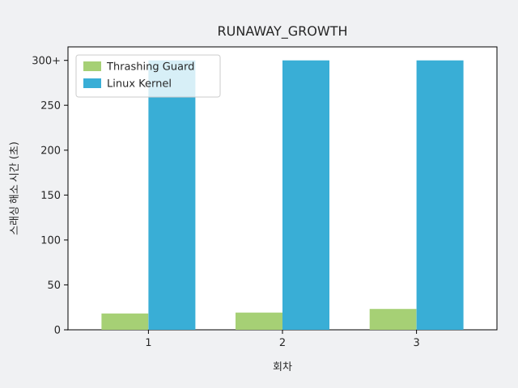
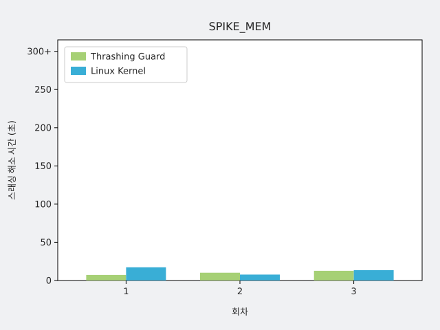

# M4 효과 검증 요약

- 입력: `results/m4/2026-11-13` (실행 15개). 결과 루트 하나의 실행만 모은다. 보정용 실행은 `results/m4/smoke`, `results/m4/prelim`에 따로 있고 본 실행의 평가에는 쓰지 않는다.
- 해소 시간은 T0(SSH 프로브 3번 연속 실패)부터 해소(5번 연속 성공)까지이고, T0 이후 300초 안에 풀리지 않으면 미해소다.
- 판정 기준은 임시값이며([docs/validation/overview.md](../../../docs/validation/overview.md) 5절), 각 부하 3회씩의 관찰이다.

## 합불 판정

| 항목 | 주장 | 결과 | 근거 |
|---|---|---|---|
| 해소 시간 (RUNAWAY_GROWTH) | V2 | **합격** | 켜짐 중앙값 19.2초 / dry-run 중앙값 미해소, 켜짐 최악 23.2초 |
| 해소 시간 (SPIKE_MEM) | V2 | **합격** | 켜짐 중앙값 10.2초 / dry-run 중앙값 13.5초, 켜짐 최악 12.7초 |
| E 생존 | V3 | **합격** | 켜짐 6회 모두 E가 종료되지 않고 active |
| 정상 버스트 | V4 | **합격** | 3회 모두 종료 결정 0건 |

## 해소 시간 그래프

회차마다 왼쪽(초록)이 Thrashing Guard(데몬 켜짐), 오른쪽(파랑)이 Linux Kernel(dry-run, 데몬 꺼짐 대용)이다. 300초까지 찬 막대는 T0 이후 5분 안에 풀리지 않은 실행(미해소)이다. 막대가 없는 자리는 해소 시간을 낼 수 없는 실행(스래싱 미발생, 창 잘림 등)이거나 실행이 없는 경우이며, 아래 실행 목록에서 확인한다.

## 해소 시간

| 부하 | 조건 | 실행 | 상태 | 해소 시간 중앙값(초) | 범위(초) | T0 중앙값(초) | 감지 지연(초) | 종료→해소(초) |
|---|---|---|---|---|---|---|---|---|
| RUNAWAY_GROWTH | dry | 3 | resolved 1, unresolved 2 | 미해소 | 20.2~미해소 | 156.8 | 11.2 | - |
| RUNAWAY_GROWTH | kill | 3 | resolved 3 | 19.2 | 18.2~23.2 | 160.9 | 11.4 | 7.4 |
| SPIKE_MEM | dry | 3 | resolved 3 | 13.5 | 7.7~17.3 | 1.6 | 1.4 | - |
| SPIKE_MEM | kill | 3 | resolved 3 | 10.2 | 7.3~12.7 | 3.5 | 4.1 | 6.1 |
| 정상 버스트 | dry | 3 | no_thrash 3 | - | - | - | - | - |

## 기록 지표 (합불에 쓰지 않음)

| 부하 | 조건 | E 카나리 최대 무응답 중앙값(초) | 범위(초) | 카나리 성공률 중앙값 | SSH 최대 무응답 중앙값(초) | 데몬 선행 | 커널 OOM 실행 | 종료 결정 수 |
|---|---|---|---|---|---|---|---|---|
| RUNAWAY_GROWTH | dry | 7.1 | 2.2~67.7 | 73% | 300.0 | kernel 2, none 1 | 2 | 7 |
| RUNAWAY_GROWTH | kill | 1.6 | 1.6~2.3 | 100% | 16.2 | daemon 3 | 0 | 3 |
| SPIKE_MEM | dry | 3.4 | 2.3~5.2 | 64% | 13.5 | kernel 3 | 3 | 1 |
| SPIKE_MEM | kill | 3.3 | 2.4~4.1 | 64% | 10.1 | daemon 3 | 0 | 3 |
| 정상 버스트 | dry | 1.2 | 1.0~1.4 | 100% | 4.1 | none 3 | 0 | 0 |

## 주의할 실행

- `normal_burst-dry-1`: SSH 기준과 PSI 보조 기록의 T0가 어긋난다
- `normal_burst-dry-3`: SSH 기준과 PSI 보조 기록의 T0가 어긋난다
- `runaway_growth-dry-1`: 샘플 누락으로 무효인 1초 구간이 1개 있다
- `spike_mem-dry-2`: SSH 기준과 PSI 보조 기록의 T0가 어긋난다
- `spike_mem-dry-3`: SSH 기준과 PSI 보조 기록의 T0가 어긋난다
- `spike_mem-kill-1`: SSH 기준과 PSI 보조 기록의 T0가 어긋난다

## 실행 목록

| 실행 | 부하 | 조건 | 상태 | T0(초) | 해소 시간(초) | 데몬 결정(초) |
|---|---|---|---|---|---|---|
| normal_burst-dry-1 | normal_burst | dry | no_thrash | - | - | - |
| normal_burst-dry-2 | normal_burst | dry | no_thrash | - | - | - |
| normal_burst-dry-3 | normal_burst | dry | no_thrash | - | - | - |
| runaway_growth-dry-1 | runaway_growth | dry | unresolved | 156.8 | - | 167.0 |
| runaway_growth-dry-2 | runaway_growth | dry | resolved | 152.0 | 20.2 | 164.9 |
| runaway_growth-dry-3 | runaway_growth | dry | unresolved | 163.0 | - | 174.2 |
| runaway_growth-kill-1 | runaway_growth | kill | resolved | 156.9 | 18.2 | 167.9 |
| runaway_growth-kill-2 | runaway_growth | kill | resolved | 160.9 | 19.2 | 172.3 |
| runaway_growth-kill-3 | runaway_growth | kill | resolved | 163.1 | 23.2 | 179.0 |
| spike_mem-dry-1 | spike_mem | dry | resolved | 1.6 | 17.3 | - |
| spike_mem-dry-2 | spike_mem | dry | resolved | 5.5 | 7.7 | 6.9 |
| spike_mem-dry-3 | spike_mem | dry | resolved | 0.6 | 13.5 | - |
| spike_mem-kill-1 | spike_mem | kill | resolved | 5.5 | 7.3 | 5.9 |
| spike_mem-kill-2 | spike_mem | kill | resolved | 3.5 | 10.2 | 7.6 |
| spike_mem-kill-3 | spike_mem | kill | resolved | 1.5 | 12.7 | 8.2 |
